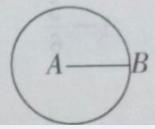

# Mathematics (Grade 6)

**ID**: 975a379b
**难度**: medium
**题型**: short_answer

## 题目
想一想，你怎样判断AB是不是圆的半径，说出你的办法．

## 解答

**答案**: 以A点为圆心，以AB为半径，用圆规画圆，如果与所给圆重合，则AB是圆的半径.如果不重合，则不是.

1. Step1:确定圆心为A点
2. Step2:设定圆规半径为AB
3. Step3:用圆规以A点为圆心、AB为半径画圆
4. Step4:观察所画的圆与给定的圆是否重合
5. Step5:若重合，得出AB是圆的半径；若不重合，得出AB不是圆的半径

## 知识点

**知识点**:
  - --

---
