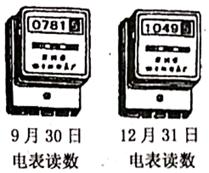

# Mathematics (Grade 6)

**ID**: 97fc9795
**难度**: medium
**题型**: short_answer

## 题目
小明家第四季度用电量如电表读数，已知十月份用电70度，十一月份与十二月份用电量的比是$5:6$，小明家十二月份用电多少度？

## 解答

**答案**: 108度

1. Step1:先计算第四季度总用电量，用12月31日电表读数减去9月30日电表读数，即1049 - 781
2. Step2:再计算出十一月和十二月的总用电量，用第四季度总用电量减去十月份用电量，为1049 - 781 - 70
3. Step3:计算十一月份与十二月份用电量份数之和，5 + 6 = 11
4. Step4:计算十二月份用电量，用十一月和十二月的总用电量乘以十二月份占比，即(1049 - 781 - 70)×$\frac{6}{11}$，结果为108度

## 知识点

**知识点**:
  - 小学数学;数与代数;比和比例;比;按比例分配问题

---
