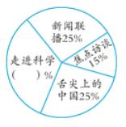

# Mathematics (Grade 6)

**ID**: 9ba083c4
**难度**: medium
**题型**: short_answer

## 题目
下图是一位学生调查学校老师们喜欢看的电视节目的统计图。

（1）将统计图补充完整。
（2）如果喜欢《焦点访谈》的老师有12人，那么有多少名老师喜欢收看《舌尖上的中国》？

## 解答

**答案**: 35, 20

1. Step1:把整个圆看作单位'1'，已知新闻联播占25%，焦点访谈占15%，舌尖上的中国占25%，所以走进科学所占比例为1 - 25% - 15% - 25% = 35%，完成统计图补充
2. Step2:因为喜欢《焦点访谈》的老师有12人，且其占比为15%，所以老师总人数为12÷15% = 80人
3. Step3:已知喜欢《舌尖上的中国》的老师占比25%，老师总人数为80人，所以喜欢收看《舌尖上的中国》的老师人数为80×25% = 20人

## 知识点

**知识点**:
  - 小学数学;统计和概率;统计;统计图表的综合应用

---
