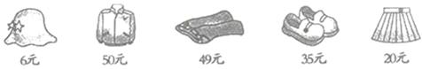

# Mathematics (Grade 6)

**ID**: 9f47efaa
**难度**: medium
**题型**: short_answer

## 题目
解决问题。

（1）上衣比裙子贵多少元？   
（2）小丽买一双鞋找回了5元，小丽付了多少元？   
（3）先买一件上衣再买一条裤子总共花多少钱？

## 解答

**答案**: 30元, 40元, 99元

1. Step1:计算上衣比裙子贵的金额，用上衣价格50元减去裙子价格20元，即50 - 20 = 30元
2. Step2:计算小丽付的钱数，因为买一双35元的鞋找回5元，所以付的钱是鞋的价格加上找回的钱，即35 + 5 = 40元
3. Step3:计算先买一件上衣再买一条裤子总共花的钱，上衣价格50元加上裤子价格49元，即50 + 49 = 99元

## 知识点

**知识点**:
  - 小学数学;数与代数;数的运算;整数的四则运算

---
