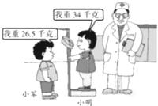

# Mathematics (Grade 6)

**ID**: 9f64c601
**难度**: medium
**题型**: short_answer

## 题目
如图，小军比小明轻多少千克？

## 解答

**答案**: 7.5

1. Step1:明确问题是求小军比小明轻的千克数
2. Step2:根据解析2可知，用小明的质量减去小军的质量来计算，即34 - 26.5
3. Step3:计算34 - 26.5的结果为7.5千克，此即为小军比小明轻的质量

## 知识点

**知识点**:
  - 小数的加法和减法．

---
