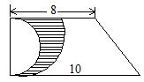

# Mathematics (Grade 6)

**ID**: a50eeb47
**难度**: medium
**题型**: short_answer

## 题目
已知图中梯形的面积是54平方厘米，求图中阴影部分的面积．

## 解答

**答案**: 14.13

1. Step1:根据梯形面积公式S=(a+b)×h÷2（其中S为面积，a为上底，b为下底，h为高），已知梯形面积是54平方厘米，上底8厘米，下底10厘米，计算梯形的高，即54×2÷（10 + 8）= 6厘米，此高也是大圆半径。
2. Step2:计算四分之一大圆的面积，根据圆的面积公式S = πr²，可得四分之一大圆面积为3.14×6²×(1/4)。
3. Step3:计算半圆的面积，已知半圆半径为6÷2 = 3厘米，根据圆的面积公式可得半圆面积为3.14×(6÷2)²×(1/2)。
4. Step4:用四分之一大圆的面积减去半圆的面积，即3.14×6²×(1/4) - 3.14×(6÷2)²×(1/2) = 14.13平方厘米，得到阴影部分面积。

## 知识点

**知识点**:
  - 小学数学;数与代数;应用题;面积、体积相关应用题;组合图形应用题

---
