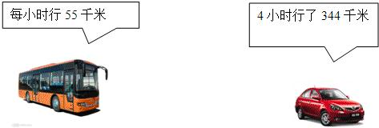

# Mathematics (Grade 6)

**ID**: a7fe44d1
**难度**: medium
**题型**: short_answer

## 题目
大客车比小轿车每小时慢多少千米？     

## 解答

**答案**: 31

1. Step1:根据速度=路程÷时间，由小轿车4小时行了344千米，可得小轿车的速度为344÷4 = 86千米/小时
2. Step2:已知大客车速度是每小时55千米，用小轿车速度86千米/小时减去大客车速度55千米/小时，即86 - 55 = 31千米，得出大客车比小轿车每小时慢31千米

## 知识点

**知识点**:
  - 整数、小数复合应用题．

---
