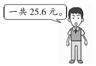

# Mathematics (Grade 6)

**ID**: adf5e4de
**难度**: medium
**题型**: short_answer

## 题目
鸡蛋每千克5.4元，小红买4kg鸡蛋，店主算得对吗？

## 解答

**答案**: 21.6, 不对

1. Step1:根据题目，已知鸡蛋每千克5.4元，小红买4kg，根据总价 = 单价×数量，可得应计算5.4×4
2. Step2:计算5.4×4的结果为21.6元
3. Step3:已知店主算的总价是25.6元，将计算出的21.6元与25.6元比较大小
4. Step4:因为21.6＜25.6，所以得出店主算得不对

## 知识点

**知识点**:
  - 小数乘法

---
