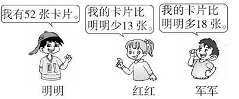

# Mathematics (Grade 6)

**ID**: b39d56fb
**难度**: medium
**题型**: short_answer

## 题目

(1)红红有多少张卡片？
(2)军军有多少张卡片？

## 解答

**答案**: 39张, 70张

1. Step1:已知明明有52张卡片，红红卡片比明明少13张，用明明的卡片数52减去13，即52 - 13，可得红红卡片数
2. Step2:计算52 - 13 = 39，所以红红有39张卡片
3. Step3:已知明明有52张卡片，军军卡片比明明多18张，用明明的卡片数52加上18，即52 + 18，可得军军卡片数
4. Step4:计算52 + 18 = 70，所以军军有70张卡片

## 知识点

**知识点**:
  - 小学数学;数与代数;应用题;简单应用题;整数简单应用题

---
