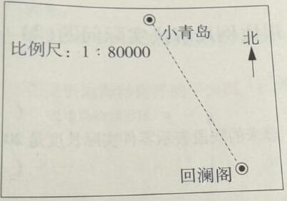

# Mathematics (Grade 6)

**ID**: ba4c1501
**难度**: medium
**题型**: short_answer

## 题目

 比例尺1：80000
 小青岛  回澜阁
 小请岛和回澜阁之间的实际距离是多少米？

## 解答

**答案**: 4800

1. Step1:明确比例尺为1：80000，即图上1厘米代表实际距离80000厘米
2. Step2:量得小青岛和回澜阁之间的图上距离为6厘米
3. Step3:根据实际距离=图上距离×比例尺，计算实际距离为6×80000 = 480000厘米
4. Step4:将480000厘米换算为米，因为1米=100厘米，所以480000厘米÷100 = 4800米

## 知识点

**知识点**:
  - 

---
