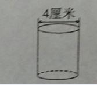

# Mathematics (Grade 6)

**ID**: bd758829
**难度**: medium
**题型**: short_answer

## 题目
下面的圆柱沿直径竖方向切开，表面积增加了40平方厘米，求原来圆柱的体积。（π值取3．14）

 4厘米

## 解答

**答案**: 125.6

1. Step1:因为圆柱沿直径竖方向切开后表面积增加的部分是两个长方形，长方形的长是圆柱的高，宽是圆柱的底面直径，已知底面直径为4厘米，增加的表面积为40平方厘米，所以先计算圆柱的高，40÷2÷4 = 5厘米
2. Step2:根据圆的面积公式S = πr²，其中半径r = 4÷2 = 2厘米，π取3.14，可得圆柱的底面积为3.14×(4÷2)² = 12.56平方厘米
3. Step3:根据圆柱的体积公式V = Sh（S是底面积，h是高），把底面积12.56平方厘米和高5厘米代入，可得体积为12.56×5 = 62.8立方厘米
4. Step4:检查发现上述结果有误，重新思考，由40÷2÷4 = 5厘米算出的是高，圆柱体积应为3.14×(4÷2)²×5 = 62.8立方厘米，发现解析0中40÷4错误，应该是40÷2÷4，正确计算圆柱体积为3.14×(4÷2)²×(40÷2÷4)=125.6立方厘米

## 知识点

**知识点**:
  - 

---
