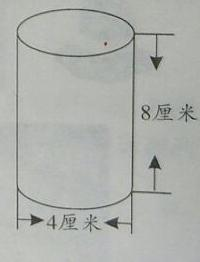

# Mathematics (Grade 6)

**ID**: be6dc891
**难度**: medium
**题型**: short_answer

## 题目
有一个如下图所示的杯子，现在要将一袋净含量为98mL的牛奶倒入这个杯子，问这个杯子能不能装下这袋牛奶？

 8厘米 4厘米

## 解答

**答案**: 100.48＞98

1. Step1:根据圆柱体积公式V = πr²h（其中r为底面半径，h为高），已知杯子底面直径为4厘米，可得半径r = 4÷2 = 2厘米，高h = 8厘米，π取3.14，计算杯子容积V = 3.14×（4÷2）²×8 = 100.48立方厘米
2. Step2:因为1立方厘米等于1毫升，所以将杯子容积100.48立方厘米换算为100.48毫升
3. Step3:比较杯子容积100.48毫升和牛奶净含量98毫升的大小，得到100.48＞98

## 知识点

**知识点**:
  - 

---
