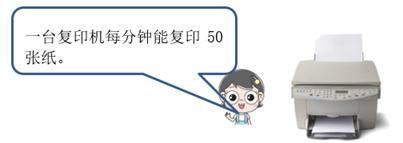

# Mathematics (Grade 6)

**ID**: c4f0637a
**难度**: medium
**题型**: short_answer

## 题目
要复印一份272页的书稿，5分钟能复印完吗？

## 解答

**答案**: 5分钟印不完

1. Step1:根据已知条件，一台复印机每分钟能复印50张纸，计算5分钟能复印的纸张数，即50×5 = 250（页）
2. Step2:将5分钟能复印的纸张数250页与书稿的页数272页进行比较，250＜272
3. Step3:根据比较结果得出结论，5分钟不能复印完

## 知识点

**知识点**:
  - 小学数学;数与代数;数的运算;整数的四则运算

---
