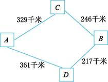

# Mathematics (Grade 6)

**ID**: c7d5a437
**难度**: medium
**题型**: short_answer

## 题目
救援队要把救援车从$\textit{A}$地开到$\textit{B}$地,请你帮助救援队设计一下,走哪条路比较近。

## 解答

**答案**: 走经过C地的那条路比较近。

1. Step1:计算从A地经过C地到B地的路程，329 + 246 = 575千米
2. Step2:计算从A地经过D地到B地的路程，361 + 217 = 578千米
3. Step3:比较两条路线的路程，575 < 578
4. Step4:得出结论，走经过C地的那条路比较近

## 知识点

**知识点**:
  - 小学数学;数与代数;应用题;复合应用题;整数四则复合应用题

---
