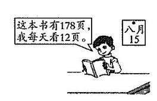

# Mathematics (Grade 6)

**ID**: c9100be1
**难度**: medium
**题型**: short_answer

## 题目
小明能在9月1日开学前看完这本书吗？

 这本书有178页，我每天看12页  八月15

## 解答

**答案**: 204＞178

1. Step1:计算从8月15日到8月31日的天数，8月一共31天，31 - 15 + 1 = 17天
2. Step2:根据每天看12页，计算17天一共能看的页数，12×17 = 204页
3. Step3:比较17天能看的204页和书的总页数178页，得到204＞178

## 知识点

**知识点**:
  - 两、三位数除以两位数-整理与练习（2）
-

---
