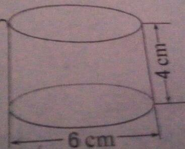

# Mathematics (Grade 6)

**ID**: cb5941b1
**难度**: medium
**题型**: short_answer

## 题目
计算下面图形的侧面积和表面积

 6cm   4cm

## 解答

**答案**: 75.36, 131.88

1. Step1:根据圆柱侧面积公式，底面直径为6厘米，高为4厘米，侧面积为6×3.14×4=75.36平方厘米
2. Step2:由底面直径6厘米可得底面半径为6÷2=3厘米
3. Step3:根据圆的面积公式，底面积为3×3×3.14，因为有两个底面，所以两个底面积为3×3×3.14×2=56.52平方厘米
4. Step4:根据圆柱表面积公式，表面积为两个底面积加上侧面积，即56.52+75.36=131.88平方厘米

## 知识点

**知识点**:
  - 

---
