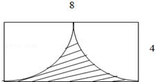

# Mathematics (Grade 6)

**ID**: d06f4186
**难度**: medium
**题型**: short_answer

## 题目
求图形的周长（单位：cm）

## 解答

**答案**: 20.56

1. Step1:明确图形的周长由半径为4cm的半圆的弧长和长方形的一条长边8cm组成
2. Step2:根据圆的周长公式C = 2πr（r为半径），计算半圆的弧长，半圆的弧长为圆周长的一半，即3.14×4×2÷2
3. Step3:将半圆的弧长与长方形的长边8cm相加，即3.14×4×2÷2 + 8
4. Step4:先计算3.14×4×2÷2 = 12.56
5. Step5:再计算12.56 + 8 = 20.56，得到图形的周长

## 知识点

**知识点**:
  - 圆、圆环的周长

---
