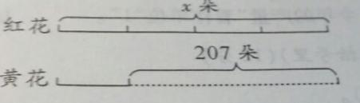

# Mathematics (Grade 6)

**ID**: d09e0f43
**难度**: medium
**题型**: short_answer

## 题目

 黄花为红花的
 $\frac{1}{4}$
  ，红花比黄花多207朵，求红花朵数？

## 解答

**答案**: 276

1. Step1:设红花有x朵，因为黄花为红花的$\frac{1}{4}$，所以黄花有$\frac{1}{4}x$朵
2. Step2:已知红花比黄花多207朵，根据”红花朵数 - 黄花朵数 = 207”，可列出方程$x - \frac{1}{4}x = 207$
3. Step3:解方程$x - \frac{1}{4}x = 207$，先合并同类项得到$\frac{3}{4}x = 207$
4. Step4:等式两边同时除以$\frac{3}{4}$，即$x = 207\div\frac{3}{4}=207\times\frac{4}{3}=276$，得到红花朵数为276朵

## 知识点

**知识点**:
  - --

---
