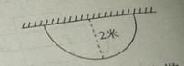

# Mathematics (Grade 6)

**ID**: d2118070
**难度**: medium
**题型**: short_answer

## 题目
用篱笆围成一个半圆形的养鸡场，（如图所示）一边靠墙，这个养鸡场的面积是多少平方米？

 2米

## 解答

**答案**: 6.28

1. Step1:明确养鸡场是半圆形，其半径为2米
2. Step2:根据圆的面积公式S = πr²，先计算半径为2米的整圆面积，即3.14×2²
3. Step3:因为养鸡场是半圆，所以将整圆面积除以2，得到3.14×2²÷2
4. Step4:计算3.14×2²÷2 = 3.14×4÷2 = 12.56÷2 = 6.28平方米，此即为养鸡场面积

## 知识点

**知识点**:
  - 

---
