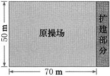

# Mathematics (Grade 6)

**ID**: d7625ae1
**难度**: medium
**题型**: short_answer

## 题目
如图，希望小学扩建操场，扩建部分的面积是原面积的15%．

（1）扩建后操场面积是多少？
（2）扩建部分每平方米需投入200元，共需投入多少元？

## 解答

**答案**: 4025, 105000

1. Step1:根据长方形面积公式，计算原操场面积为50×70 = 3500平方米
2. Step2:计算扩建部分面积，为原操场面积乘以15%，即3500×15% = 525平方米
3. Step3:计算扩建后操场面积，为原操场面积加上扩建部分面积，即3500 + 525 = 4025平方米
4. Step4:计算扩建部分投入金额，为扩建部分面积乘以每平方米投入的200元，即525×200 = 105000元

## 知识点

**知识点**:
  - 小学数学;数与代数;数的运算;百分数的四则运算;图形与几何;平面图形;长方形和正方形;长方形的面积

---
