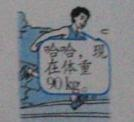

# Mathematics (Grade 6)

**ID**: dad5899e
**难度**: medium
**题型**: short_answer

## 题目
李叔叔很胖，原来体重是110kg，锻炼之后的体重比原来减少了百分之几？

 哈哈，现在体重90kg．

## 解答

**答案**: 18.2%

1. Step1:先计算出体重减少的量，用原来的体重110kg减去现在的体重90kg，即110 - 90 = 20kg
2. Step2:根据求一个数是另一个数的百分之几用除法计算，用减少的体重20kg除以原来的体重110kg，再乘以100%，即(110 - 90)÷110×100%
3. Step3:计算(110 - 90)÷110×100% = 20÷110×100%，结果约为18.2%

## 知识点

**知识点**:
  - --

---
