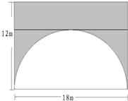

# Mathematics (Grade 6)

**ID**: e1ce2194
**难度**: medium
**题型**: short_answer

## 题目
求阴影的周长和面积

## 解答

**答案**: 70.26, 88.83

1. Step1:分析阴影部分周长的组成，可知是由长方形的两条宽、一条长以及半圆的弧长组成，根据公式计算，长方形宽为12米，长为18米，半圆直径为18米，弧长为3.14×18÷2，所以周长计算式为12×2+18+3.14×18÷2，计算可得24+18+28.26=70.26米
2. Step2:分析阴影部分面积的组成，可知是由长方形面积减去半圆的面积，长方形面积为18×12，半圆半径为18÷2，半圆面积为3.14×（18÷2）²÷2，所以面积计算式为18×12 - 3.14×（18÷2）²÷2，计算可得216 - 3.14×81÷2=216 - 127.17=88.83平方米

## 知识点

**知识点**:
  - 

---
