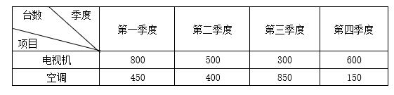

# Mathematics (Grade 6)

**ID**: e8377c26
**难度**: medium
**题型**: short_answer

## 题目
商场去年电视、空调销售情况统计表如下：
（1）全年销售电视机多少台？空调多少台？
（2）哪个季度销售电视最多？哪个季度销售空调最少？

## 解答

**答案**: 2200, 1850, 第一季度, 第四季度

1. Step1:计算全年销售电视机的台数，将四个季度电视机的销售量相加，即800 + 500 + 300 + 600 = 2200台
2. Step2:计算全年销售空调的台数，把四个季度空调的销售量相加，即450 + 400 + 850 + 150 = 1850台
3. Step3:比较四个季度电视机的销售量800、500、300、600，可得第一季度800台最多
4. Step4:比较四个季度空调的销售量450、400、850、150，可知第四季度150台最少

## 知识点

**知识点**:
  - 小学数学;统计和概率;统计;数据的搜集与整理;统计表

---
