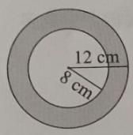

# Mathematics (Grade 6)

**ID**: e8d51b14
**难度**: medium
**题型**: short_answer

## 题目
求下图中阴影部分的面积：
   大圆半径12cm，小圆半径8cm

## 解答

**答案**: 80πcm²

1. Step1:明确圆环面积的计算公式为圆环面积 = 大圆面积 - 小圆面积
2. Step2:根据圆的面积公式S = πr²，计算大圆面积为π×12² = 144π（cm²）
3. Step3:根据圆的面积公式S = πr²，计算小圆面积为π×8² = 64π（cm²）
4. Step4:用大圆面积减去小圆面积得到阴影部分（圆环）的面积，即144π - 64π = 80π（cm²）

## 知识点

**知识点**:
  - --

---
