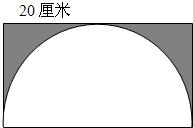

# Mathematics (Grade 6)

**ID**: ec558c6b
**难度**: medium
**题型**: short_answer

## 题目
(2009•华亭县)求图中阴影部分的面积．

## 解答

**答案**: 43

1. Step1:根据图可知圆的直径为20厘米，计算圆的半径，20÷2 = 10厘米
2. Step2:计算长方形的面积，长方形长20厘米，宽为圆的半径10厘米，面积为20×10 = 200平方厘米
3. Step3:计算半圆的面积，根据圆的面积公式S = πr²，半圆面积为3.14×10²×1/2 = 157平方厘米
4. Step4:计算阴影部分面积，用长方形面积减去半圆面积，200 - 157 = 43平方厘米

## 知识点

**知识点**:
  - 组合图形的面积;长方形、正方形的面积;圆、圆环的面积．

---
