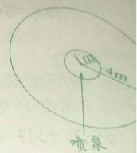

# Mathematics (Grade 6)

**ID**: ef57441a
**难度**: medium
**题型**: short_answer

## 题目
在一块圆形空地中央修了一个圆形喷泉（如下图），剩下的部分栽花，则栽花的面积是多少平方米？

## 解答

**答案**: 47.1

1. Step1:明确求栽花的面积就是求圆环的面积，圆环面积等于外圆面积减去内圆面积
2. Step2:根据圆的面积公式S = πr²，外圆半径为4米，计算外圆面积为3.14×4×4
3. Step3:内圆半径为1米，计算内圆面积为3.14×1×1
4. Step4:用外圆面积3.14×4×4减去内圆面积3.14×1×1，即3.14×4×4 - 3.14×1×1 = 47.1平方米

## 知识点

**知识点**:
  - --

---
