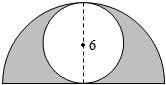

# Mathematics (Grade 6)

**ID**: f946ad99
**难度**: medium
**题型**: short_answer

## 题目
求阴影部分的面积．（单位：厘米）

## 解答

**答案**: 28.26

1. Step1:根据图可知小圆的直径等于大半圆的半径，已知小圆直径为6厘米，所以大半圆半径为6厘米，小圆半径为6÷2 = 3厘米
2. Step2:根据圆的面积公式S = 3.14×半径×半径，计算大半圆的面积为3.14×6×6÷2
3. Step3:根据圆的面积公式计算小圆的面积为3.14×3×3
4. Step4:用大半圆的面积减去小圆的面积，即3.14×6×6÷2 - 3.14×3×3
5. Step5:对3.14×6×6÷2 - 3.14×3×3进行变形，得到3.14×(18 - 9)
6. Step6:计算3.14×(18 - 9)的结果为28.26平方厘米，此即为阴影部分面积

## 知识点

**知识点**:
  - 组合图形的面积

---
