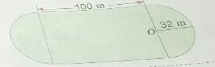

# Mathematics (Grade 6)

**ID**: fa3122ee
**难度**: medium
**题型**: short_answer

## 题目
一个运动场如右图，两端是半圆形， 中间是长方形，这个运动场的周长是多少米？面积是多少平方米？

 100m，32m

## 解答

**答案**: 400.96, 9615.36

1. Step1:明确运动场周长由两个100米的直道长度和一个以32米为半径的圆的周长组成，根据圆的周长公式C = 2πr（r为半径），可得圆的周长为3.14×32×2，所以周长为2×100 + 3.14×32×2 = 200 + 200.96 = 400.96米
2. Step2:明确运动场面积由一个以32米为半径的圆的面积和一个长为100米、宽为32×2米的长方形的面积组成，根据圆的面积公式S = πr²（r为半径），可得圆的面积为3.14×32² = 3215.36平方米，长方形面积为100×32×2 = 6400平方米，所以面积为3.14×32² + 100×32×2 = 3215.36 + 6400 = 9615.36平方米

## 知识点

**知识点**:
  - 

---
