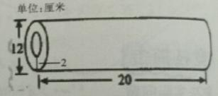

# Mathematics (Grade 6)

**ID**: fb96afe2
**难度**: medium
**题型**: short_answer

## 题目
这根钢管的管壁厚2厘米，求钢管的体积。

 单位：里面
 12
 2
 20

## 解答

**答案**: 3830.8cm³

1. Step1:先计算大圆柱的底面半径，由图可知大圆柱底面直径为12厘米，所以大圆柱底面半径为12÷2 = 6厘米
2. Step2:计算大圆柱的体积，根据圆柱体积公式V = πr²h，其中π取3.14，h为高20厘米，所以大圆柱体积为3.14×6²×20
3. Step3:计算小圆柱的底面半径，因为管壁厚2厘米，所以小圆柱底面直径为12 - 2×2 = 8厘米，小圆柱底面半径为8÷2 = 4厘米
4. Step4:计算小圆柱的体积，根据圆柱体积公式，小圆柱体积为3.14×4²×20
5. Step5:用大圆柱体积减去小圆柱体积得到钢管体积，即3.14×6²×20 - 3.14×4²×20 = 3830.8立方厘米

## 知识点

**知识点**:
  - 

---
