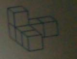

# Mathematics (Grade 6)

**ID**: fc4c3e79
**难度**: medium
**题型**: short_answer

## 题目
由6个大小相同的正方体搭成的物体如图所示，那么它的三个视图的面积是否相等，若不相等，哪个视图的面积最大？

## 解答

**答案**: 4, 5, 俯视图

1. Step1:设正方体的边长为1，每个面的面积为1×1=1
2. Step2:计算正视图面积，可看到3个正方形的面和1个正方形的面，面积为3×1 + 1×1 = 4
3. Step3:计算侧视图面积，同样可看到3个正方形的面和1个正方形的面，面积为3×1 + 1×1 = 4
4. Step4:计算俯视图面积，可看到3个正方形的面和2个正方形的面，面积为3×1 + 2×1 = 5
5. Step5:比较三个视图面积，4＜5，所以俯视图面积最大

## 知识点

**知识点**:
  - --

---
