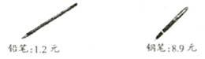

# Mathematics (Grade 6)

**ID**: ffcd425c
**难度**: medium
**题型**: short_answer

## 题目

(1)买一支铅笔和一支钢笔,一共要付多少元?
(2)一支钢笔比一支铅笔贵多少元?

## 解答

**答案**: 10.1元, 7.7元

1. Step1:求买一支铅笔和一支钢笔一共要付的钱数，需将铅笔单价1.2元和钢笔单价8.9元相加，即1.2 + 8.9 = 10.1元
2. Step2:求一支钢笔比一支铅笔贵的钱数，要用钢笔单价8.9元减去铅笔单价1.2元，即8.9 - 1.2 = 7.7元

## 知识点

**知识点**:
  - 小学数学;数与代数;应用题;常见的数学问题;经济问题;简单应用题;小数加法、减法应用题

---
